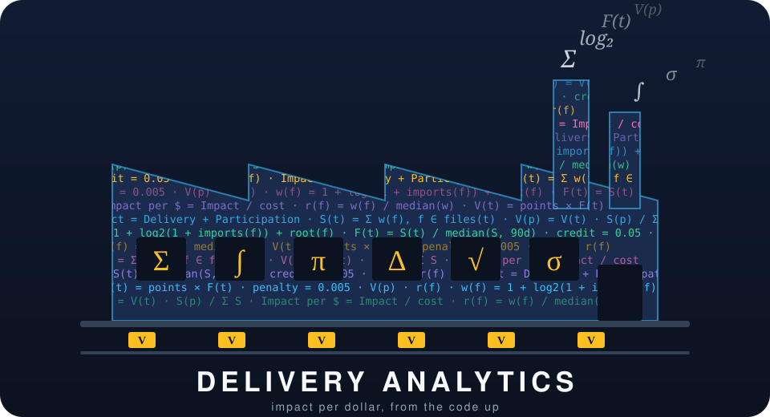
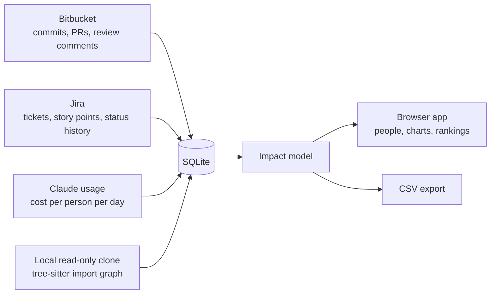

<p align="center">
  
</p>

<h1 align="center">Delivery Analytics</h1>

<p align="center"><b>What did each developer deliver, what did the AI cost, and was it worth it?</b><br>
A local app that turns Bitbucket, Jira and Claude Code usage into one number per person: <i>impact per dollar</i>.</p>

---

## What it does

Counting commits and pull requests does not show who moved the product forward, and it gets *less* useful once people work with AI tools, because volume rises for everyone. Delivery Analytics measures what was **delivered**:

- **Delivery.** A finished ticket is worth its story points, scaled by how much of the codebase the change touched, and credited to the people whose pull requests delivered it.
- **Participation.** A review comment that made the author change the code earns the reviewer a share of that pull request. Approvals count for half a comment.
- **Cost.** Claude usage is attributed to the tickets a person worked on, so you can read **impact per dollar**.
- **Trend.** Rolling 30-day charts against a team median, so one large ticket does not hide a quiet month.

It runs on your machine, reads from Bitbucket, Jira and Anthropic, never writes to them, and answers on localhost only. It is a **calibration aid for check-ins, not a verdict**: it cannot see pairing, mentoring, prompt quality or how someone takes feedback.



## How impact is calculated

Every ticket with story points is valued, then shared between the pull request authors (**Delivery**) and the reviewers whose comments led to a change (**Participation**).

**Impact = Delivery + Participation** &nbsp;·&nbsp; **Impact per dollar = Impact / Claude cost**

```
File weight          w(f)  = 1 + log2(1 + number of files that import f) + 1 if f is an entry or root file
Relative weight      r(f)  = w(f) / median file weight in the repository
Ticket scope         S(t)  = sum of w(f) over each distinct file changed by the ticket's pull requests
Scope factor         F(t)  = S(t) / median ticket scope over the previous 90 days   (1 with fewer than 5 tickets)
Ticket value         V(t)  = story points x F(t)
Pull request value   V(p)  = V(t) x S(p) / sum of S over the ticket's pull requests

For each review comment that led to a change in the code:
  Reviewer credit    0.05  x V(p) x r(f)     (one reviewer's total on a pull request is capped at V(p))
  Author penalty     0.005 x V(p) x r(f)

Delivery(P)       = sum over pull requests P authored of  V(p) x max(0, 1 - 0.005 x sum r(f))
Participation(P)  = sum over others' pull requests of     V(p) x min(1, 0.05  x sum r(f))
```

In plain words: a change to a file that many others import is worth more than a change to a leaf file; fixing a reviewer's catch in a core file costs more than in a leaf file; and a commit is not impact, a pull request is. A comment counts as acted on when a later commit changes the same file within 10 lines of it before the pull request closes.

**Who gets the points.** Jira `Dev1` and `Dev2` first (half each when both are set and differ), then Claude-era evidence, then linked pull request authors, then the assignee. A ticket counts from the first time it reached **Dev Done** or later, and the Jira sync also pulls tickets from other projects when a team member is Dev1 or Dev2.

Reviewing is also reported separately: **PRs reviewed** (others' pull requests where you left at least one comment) and **Review value** (comments plus half a point per approval).

## What you get

| Screen | What it shows |
|---|---|
| **People** | Opens the Person view on the last person you looked at; "All people" opens the sortable matrix of Impact, Delivery and Participation |
| **Person** | A person dropdown, rolling 30-day charts against the team median (impact, delivery, participation, impact per dollar, speed, durability, PRs reviewed, review value), a "Who counts as the team?" picker, CSV download, and the tickets and pull requests behind each number |
| **Dashboard** | Throughput, time to merge, lead time, review load and work in progress |
| **Rankings** | Team members ordered by any metric, with trend and sample size |
| **Selection, Teams, Sources, Settings** | Choose repositories and projects, edit teams, see sync status, review settings (credential names only) |

## Quick start

You need [uv](https://docs.astral.sh/uv/) and `git`. The project pins **Python 3.13** because the tree-sitter packages have no wheels for newer versions yet; the package supports 3.9 and later and falls back to flat file weights without tree-sitter.

```
uv sync
cp .env.example .env                       (Windows: copy), then fill in the values
uv run delivery-analysis doctor            shows which credentials are present (names only)

uv run delivery-analysis repos add bitbucket:WORKSPACE/REPO     select a repository (checks access first)
uv run delivery-analysis projects add jira:KEY                  select a Jira project
uv run delivery-analysis teams discover --repo bitbucket:REPO --save NAME   build a team from commits

uv run delivery-analysis sync              sync every configured source
uv run delivery-analysis code build        clone, build the code graph, rebuild impact
uv run delivery-analysis serve             open the app on http://127.0.0.1:8000
```

| Variable in `.env` | Used for |
|---|---|
| `BITBUCKET` (and optional `BITBUCKET_WORKSPACE`) | Atlassian API token with `read:repository:bitbucket` and `read:pullrequest:bitbucket`; also used by git to clone |
| `ATLASSIAN`, `ATLASSIAN_EMAIL` (and `JIRA_BASE_URL`) | Jira read access; a scoped token needs `JIRA_BASE_URL=https://api.atlassian.com/ex/jira/<cloudId>` |
| `ANTHROPIC_ADMIN` (or `ANTHROPIC`) | Claude usage and cost; the Enterprise per-user cost report needs the `read:analytics` scope |

Values are never printed or stored by the app. Data lives in `delivery.sqlite` in the results folder (`GITHUB_ANALYSIS_RESULTS`, default `~/github-analysis-results`); clones sit beside it, read-only. Tests: `uv run pytest` (no network, no real credentials, made-up people only).

## What building it taught us

1. **Participation belongs inside impact.** Reviewing that changes the code is part of what gets delivered.
2. **Platform counts are the wrong headline.** Aggregate impact beats "PRs merged" or "commits".
3. **Review evidence is thin.** In the repository we measured, 87 to 100 percent of each person's review events were approvals, and fewer than one comment in twenty led to a code change. Participation is small and noisy.
4. **Counting rules decide the answer.** Counting from Dev Done and crediting Dev1 and Dev2 brought the app within 8 points of a delivery director's velocity table for all six people checked.
5. **Work outside the selected repositories is invisible**, unless a person is Dev1 or Dev2 on the ticket.
6. **AI trailers on commits measure a tool setting as much as behaviour.** Compare a person with their own earlier self, never as a score.
7. **The app measures the project it lives in.** Tickets that describe the app carry story points and can move the numbers they describe.
8. **Recent weeks look low**, because work waiting in Dev Done is understated until it moves on.

More in [docs/](docs/README.md) and [AGENTS.md](AGENTS.md).

---

## Setup and sync details

The commands above are the short path. These sections add the detail for each source.

### Teams from commit history

`delivery-analysis` builds team rosters from who actually committed, so it works for any org.

| Command | What it does |
|---------|--------------|
| `uv run delivery-analysis teams discover --repo bitbucket:REPO --since 90d` | Show who committed to the repository in the window. Saves nothing. Possible duplicates and bots are flagged |
| `uv run delivery-analysis teams discover --repo bitbucket:REPO --save NAME` | Create a team with that name and load its roster |
| `uv run delivery-analysis teams import FILE --repo bitbucket:REPO` | Load teams from a `.json` or `.yaml` file |
| `uv run delivery-analysis teams export FILE [--team NAME]` | Write active members to a `.json` or `.yaml` file |

After `delivery-analysis sync`, every team is updated: new committers are added, people with no commit in the window become inactive (never deleted), and your edits are kept. A failed sync never marks anyone inactive. `config/teams.yaml` is a local, git-ignored file; see `config/teams.example.yaml`.

### Bitbucket sync

`delivery-analysis` can sync commits, pull requests, and review activity from Bitbucket Cloud into the local database.

1. Create an Atlassian API token with `read:repository:bitbucket` and `read:pullrequest:bitbucket` and put it in `.env` as `BITBUCKET`. Optionally set `BITBUCKET_WORKSPACE` so you can use bare repo names (see `.env.example`).
2. Select a repository (this checks access first): `uv run delivery-analysis repos add bitbucket:WORKSPACE/REPO`
3. Sync: `uv run delivery-analysis sync --source bitbucket`
4. See status and detail progress: `uv run delivery-analysis repos list`
5. Build a team from the commits: `uv run delivery-analysis teams discover --repo bitbucket:REPO --save TeamName`
6. Clone the repository and build the code-weighted impact: `uv run delivery-analysis code build` (add `--repo bitbucket:REPO` for one repository). It clones read-only into the results folder, reads which files each commit changed, weighs files with a tree-sitter import graph, and rebuilds the impact tables. Review comments are fetched with the pull request detail, one request per pull request, so a first backfill of a large repository takes about one budgeted run.

The first sync covers the last 90 days. Pull request detail (merge time, review comments and approvals, file counts) is fetched in budgeted batches, newest first, so large repositories fill in over several syncs without hitting Bitbucket's rate limit. `repos list` shows how far detail has got. Assigned reviewers and whether each has approved are stored on every pull request.

### Jira sync

`delivery-analysis` can sync issues, status history, story points and issue links from a Jira Cloud project into the local database.

1. Put an Atlassian API token in `.env` as `ATLASSIAN` and the account email as `ATLASSIAN_EMAIL` (`JIRA_BASE_URL` defaults to `https://YOUR-SITE.atlassian.net`; a scoped token needs `https://api.atlassian.com/ex/jira/<cloudId>`).
2. Select a project (this checks access, picks the story points field by how many issues fill it, and seeds the status map): `uv run delivery-analysis projects add jira:MD`
3. Map any status the defaults do not know: `uv run delivery-analysis projects map jira:MD "Some Status" in_review` (categories: `todo`, `in_progress`, `in_review`, `done`, `dropped`). A sync stops with the list of unmapped statuses until they are mapped.
4. Sync: `uv run delivery-analysis sync --source jira`, then `uv run delivery-analysis projects list` to see status, issue count and points field.

`COMPLETED` is done and `DISREGARD` is `dropped` (never counted as done). Cycle time starts at the first `In Progress`. Epics, Initiatives and sub-tasks are stored but flagged `counts_for_impact = 0`. Pull requests are linked to issues when the issue key (for example `MD-12`) appears in the title or branch name; the sync prints "N of M pull requests have an issue key".

Points follow the delivery director's velocity rule: the Jira `Dev1` and `Dev2` fields are read first, a ticket counts from the first time it reached Dev Done or later, and the sync also pulls tickets from projects that are not selected when a team member is Dev1 or Dev2. Change which statuses count as delivered with `DELIVERED_STATUSES`.

---

